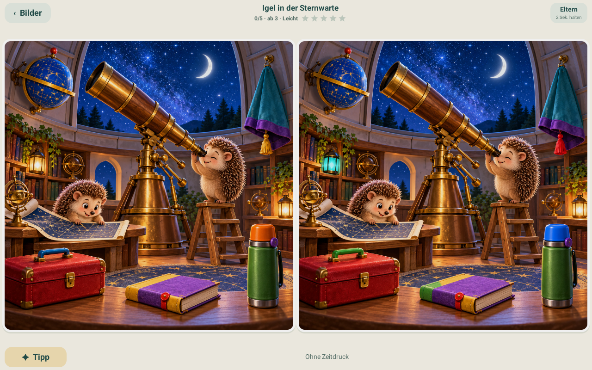

# 🔎 Fünf Entdecker

**Zwei Bilder. Fünf Unterschiede. Ganz ohne Zeitdruck.**

Ein ruhiges Suchspiel für Android- und Amazon-Fire-Tablets.

**[Version 1.0 herunterladen](https://github.com/manueloberberger/fuenf-entdecker-downloads/releases/latest/download/Fuenf-Entdecker.apk)**
&nbsp; · &nbsp;
[Alle Veröffentlichungen](https://github.com/manueloberberger/fuenf-entdecker-downloads/releases)

Keine Werbung · Kein Konto · Keine Zeitlimits

## Spielen und entdecken

45 Motive mit je einem Original und drei Vergleichsbildern: **180 Spielbilder**, immer mit genau fünf kontrollierten Unterschieden pro Stufe.

- **Zwei lokale Profile:** Entdecker ab 3 und ab 6 Jahren mit getrennten Fortschritten und Favoriten.
- **Drei Stufen:** Leicht, Mittel und Knifflig – jede mit eigenen Fehlerstellen.
- **Vollständige Bilder:** quer nebeneinander, hoch untereinander, auf beiden Seiten gleich groß.
- **In Ruhe suchen:** kein Countdown und kein automatisches Lösen.
- **Offline weiterspielen:** einmal geladene Bilder bleiben auf dem Tablet gespeichert.

Die Motive reichen von Tierabenteuern und Polartieren über Fahrzeuge, Weltraum und Dinosaurier bis zu bekannten Serienwelten. Neu dabei: Drachensteigen, Töpferstube und Sternwarte.

## Neu in Version 1.0

| Verbesserung | Im Alltag |
| --- | --- |
| Verlustfreie WebP-Bilder | Alle 45 Bilderpakete zusammen **38,37 % kleiner** – bei identischen Vollbildpixeln. |
| Schnellerer Inhaltsstart | Ein dauerhafter Inhaltsindex vermeidet wiederholtes vollständiges Hashen aller Originale. |
| Verlässliches Laden | Treffer und Tipps werden erst aktiv, wenn beide Spielbilder vollständig bereit sind. |
| Fortsetzbare Downloads | Fertige Pakete bleiben gespeichert; offene Aufträge lassen sich nach einem Neustart manuell fortsetzen. |
| Fünf Sammelsterne | Jeder gefundene Unterschied füllt einen Stern. |
| Tipps in zwei Schritten | Erst eine größere Suchregion, beim nächsten Tipp die genaue Stelle. |
| Klare Auswahl | Themen mit Symbolen, sichtbare Filter und eine direkte Rücksetz-Aktion. |
| 🎲 Überrasche mich | Ein zufälliges offenes Rätsel aus der aktuellen Themen-, Such- oder Favoritenauswahl. |
| Passendes Weiterspielen | „Weiter“ und „Weiterspielen“ bleiben innerhalb der gewählten Auswahl. |
| Eigene Sicherungsdatei | Beide Profile samt Fortschritten, Favoriten und Einstellungen exportieren und wiederherstellen. |
| Bessere Zugänglichkeit | Größere Systemschrift, zugängliche Bedienelemente und Scrollaktionen. |

**Status:** Version 1.0 ist regulär freigegeben und wird über die vorhandene Updateprüfung angeboten. Funktionen, Bilder, Migration und Oberfläche wurden im lokalen Android-Emulator geprüft. Erfahrungen vom echten Fire-Tablet fließen bei Bedarf in Folgeupdates ein.

## Installieren oder aktualisieren

1. Die gewünschte APK im **Elternprofil** des Tablets herunterladen und öffnen.
2. Die Installation aus dieser Quelle freigeben, wenn Android oder Fire OS danach fragt.
3. Eine vorhandene Installation als **normales App-Update** aktualisieren. Bilder und beide Spielstände bleiben erhalten.
4. Die App starten und angebotene **Bildaktualisierungen** laden.

Bei einer Neuinstallation lädt die App mit Internet zunächst ein passendes Motiv. Weitere Bilder lassen sich anschließend einzeln oder gemeinsam laden. Die APK selbst enthält keine Spielbilder.

Fire-Kinderprofile können Installationen und Dateiauswahl einschränken. Installation und Freigaben erfolgen daher im Elternprofil.

### PNG und WebP – automatisch passend

- **Neue Installation der 1.0:** Für die vorhandenen 45 Motive lädt die App ausschließlich WebP.
- **Vorhandene PNG-Bilder:** Sie bleiben nach dem App-Update sofort spielbar. Beim Laden der Bildaktualisierungen prüft die App das neue Paket und entfernt anschließend die alten lokalen PNG. Danach liegt das Motiv einmal als WebP auf dem Tablet.
- **Ältere Apps:** Sie lesen weiterhin den PNG-Katalog. Alle bisherigen PNG-Downloads bleiben online.

Vor dem Update können die vorhandenen Bilder auf dem Tablet bleiben. Während der Paketprüfung wird vorübergehend Platz für alte Bilder, Download und neue Dateien benötigt. Bei einem Fehler bleiben die funktionierenden Bilder erhalten.

**Gesamter Downloadbestand:** 612,8 MB PNG → 377,7 MB WebP. Keine Auflösungsreduktion und keine verlustbehaftete Kompression.

## Elternbereich, Updates und Sicherung

**„Eltern“ zwei Sekunden gedrückt halten.**

| Bereich | Möglichkeiten |
| --- | --- |
| **Bilder & Speicher** | Gespeicherte Motive suchen, auswählen, als Favoriten merken, entfernen oder gezielt erneut laden. |
| **Profile & Spiel** | Profil, Schwierigkeit, Töne, Touchflächen und Tipps einstellen; Fortschritt gezielt zurücksetzen; beide Profile sichern. |
| **App & Updates** | Neue Inhalte suchen, Bildpakete laden, pausierte Downloads fortsetzen und App-Updates vorbereiten. |

Beim Start sucht die App im Hintergrund nach neuen Bildern und App-Versionen. Ein Hinweis führt direkt zu den angebotenen Downloads. Ein App-Update wird nach Bestätigung geladen; **Android bestätigt die Installation selbst**.

### Spielstände sichern

Unter **Profile & Spiel → Spielstände beider Profile sichern** wählst du selbst eine Datei aus. Sie enthält beide Profile, Treffer aller drei Stufen, Favoriten und Spieleinstellungen. Spielbilder und APKs gehören nicht zur Sicherungsdatei.

**„Spielstände aus Datei wiederherstellen“** prüft die gewählte Datei vollständig. Erst nach deiner Bestätigung ersetzt die App die Spielstände und Einstellungen beider Profile. Fehlende Bilder lassen sich getrennt nachladen.

Eine Deinstallation oder das Löschen der Appdaten entfernt die lokal gespeicherten Bilder und Fortschritte. Eine eigene Sicherungsdatei bewahrst du außerhalb der App auf.

## Veröffentlichungen und Rückfallversion

Öffentlich steht die aktuelle **Version 1.0** bereit. Eine bewährte Vorgängerversion wird als Backup im privaten Quellrepository aufbewahrt. Überholte App-Zwischenstände und Testkandidaten werden nach der regulären Freigabe entfernt; die Quellhistorie bleibt erhalten.

Die separaten Bilderreleases bleiben erhalten: Der signierte Katalog verwendet weiterhin alle 45 PNG-Pakete für ältere Apps und 45 WebP-Pakete für Version 1.0. Bilderreleases ersetzen niemals die aktuelle App unter dem festen Downloadlink.

## Schutz und geprüfte Downloads

Keine Anmeldung, keine Werbung und kein automatischer Versand von Spielständen.

- Downloads ausschließlich aus dem festgelegten GitHub-Bereich.
- Signierter Katalog, SHA-256-Prüfsummen und begrenzte, geprüfte Bilderpakete.
- App-Updates nur mit passender Paketkennung, höherer Version und demselben Herausgeber.
- Spielstände bleiben bei regulären App- und identischen Bildformat-Updates erhalten.

Hier liegen fertige Downloads, der signierte Katalog und diese Dokumentation. Die Entwicklungsquellen und privaten Signierschlüssel werden getrennt aufbewahrt.
